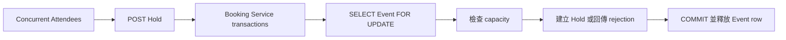

# Lesson 05 — 讓 concurrency 證據可重複

## 目標

完成這一課後，你可以：

- 區分 correctness test 與 load test 提供的證據；
- 反覆驗證 capacity、duplicate Hold 與 concurrent Confirm invariants；
- 使用 start gate 讓 concurrent requests 在相近時間開始；
- 使用 k6 產生可調整的公開 HTTP API burst；
- 分開閱讀 created、rejected、error 與 latency；
- 解釋 Event row hotspot、transaction duration 與 commit-order trade-off。

## 問題情境

Lesson 03 的一百人搶十個 Spots 證明設計可以防止超賣，但 concurrency bug 通常
取決於 timing。只成功跑過一次，不能回答以下問題：

- 同一 scenario 重跑五次是否仍維持 invariant？
- duplicate Hold 與 concurrent Confirm 是否也安全？
- 失敗時，能否看到是哪一個 request 得到錯誤結果？
- Event row lock 對 latency 有多大影響？

Lesson 05 將證據拆成兩個互補 layers。

| Layer | 回答的問題 | 不應宣稱的事情 |
|---|---|---|
| PostgreSQL integration suite | invariants 是否在已控制的 races 下成立？ | production throughput |
| k6 burst experiment | 指定環境與 load 下的 outcomes、latency 是什麼？ | 單靠一次 run 證明永不超賣 |

## 架構與 hotspot



同一 Event 的 Hold transactions 都必須經過同一把 row lock，因此熱門 Event 是
hotspot。這是刻意的簡單設計：它犧牲同一 Event 的 write concurrency，換取容易
證明的 capacity correctness。

### Transaction duration 為什麼重要？

等待時間不只取決於 lock 本身，也取決於持有 lock 的 transaction 做多久。若在
Event lock 內加入 remote call、慢 query 或不必要的 work，後方 requests 都會
累積等待時間。因此 lock 內只做 lazy expiration、active Registration lookup、
capacity count 與 insert。

### Commit order 不是 strict FIFO

RushBook 將 Spot 給最先成功 commit 的 requests，不保證最早抵達 HTTP server 的
Attendee 一定先取得 Spot。Thread scheduling、connection acquisition 與 database
lock acquisition 都可能改變順序。

若產品要求 strict FIFO，需要具有全域順序的 admission queue 或 waiting room；
不能從現在的 row lock 行為推論 FIFO fairness。

## Deterministic stress-style integration suite

[`ConcurrencyEvidenceApiIntegrationTest`](../../booking-service/src/test/java/dev/rushbook/booking/registration/ConcurrencyEvidenceApiIntegrationTest.java)
使用真實 PostgreSQL Testcontainers，並只透過公開 HTTP APIs 觀察結果。

每個 scenario 重複五次：

1. **Capacity contention**：40 位不同 Attendees 競爭 8 Spots，每次必須恰好
   8 個 `201`、32 個 `409 CAPACITY_EXHAUSTED`，且成功結果有 8 個不同的
   `registrationId`。
2. **Duplicate Hold**：20 個同 Attendee/Event requests 同時開始，只能有一個
   `201`，其餘 19 個回 `200`，所有 body 必須指向同一 Registration。
3. **Concurrent Confirm**：同一 Held Registration 同時 Confirm 20 次，全部回
   `200`，而且只有一個 `bookingId` 與一種 response body。

### Start gate

Test 先建立所有 virtual threads，等每個 request 都到達 `ready` barrier，再一次
釋放 `start` latch。這不能控制作業系統的每個 nanosecond，但比在 loop 中依序
啟動 requests 更穩定地製造 contention。

### 失敗證據

Assertions 會附上完整 observations：

```text
#7 attendee=capacity-contender-7 status=201 body={...}
#8 attendee=capacity-contender-8 status=409 body={...}
```

因此 failure 能直接區分：成功數量錯誤、unexpected status、重複 identity，或
不同 Booking results，而不是只得到「expected 8 but was 9」。

## k6 burst scenario

[`scripts/load/k6-burst.js`](../../scripts/load/k6-burst.js) 使用 `shared-iterations`：

- `ATTENDEES` 決定總 iterations；
- `CONCURRENCY` 決定同時工作的 VUs；
- `CAPACITY` 與 `HOLD_PERIOD_SECONDS` 建立本次實驗專用 Event；
- `BASE_URL` 指向 Booking Service；
- 每個 iteration 使用唯一 `attendeeId`，只呼叫 Event 與 Hold 公開 APIs。

輸出 metrics：

- `holds_created`：`201`；
- `holds_rejected`：`409 CAPACITY_EXHAUSTED`，這是合法 domain result；
- `hold_errors`：無法分類的 status/body；
- `hold_latency`：每個 Hold request 的 duration。

Script 只對 `hold_errors > 0` 設失敗 threshold，沒有把本機量到的 latency 當成
SLO。不同 CPU、PostgreSQL、connection pool 與 network 會得到不同 latency。

## 如何執行 deterministic suite

確認 Docker engine 後執行：

```bash
docker info

./gradlew --no-daemon :booking-service:test \
  --tests \
  dev.rushbook.booking.registration.ConcurrencyEvidenceApiIntegrationTest \
  --rerun-tasks
```

預期看到 15 個 executions 全部成功：3 scenarios × 5 repetitions。

執行完整 project：

```bash
./gradlew --no-daemon clean build
```

## 如何執行 k6 experiment

啟動 local-only PostgreSQL：

```bash
docker run --rm --detach \
  --name rushbook-lesson-05-postgres \
  --publish 5432:5432 \
  --env POSTGRES_DB=rushbook \
  --env POSTGRES_USER=booking_app \
  --env POSTGRES_PASSWORD=replace-me-for-local-only \
  postgres:18.3-alpine
```

啟動 Booking Service：

```bash
./gradlew --no-daemon :booking-service:bootRun
```

另一個 terminal 先跑低 concurrency baseline：

```bash
docker run --rm \
  --volume "$PWD:/workspace:ro" \
  --env BASE_URL=http://host.docker.internal:8080 \
  --env ATTENDEES=100 \
  --env CAPACITY=10 \
  --env CONCURRENCY=1 \
  grafana/k6:1.5.0 run /workspace/scripts/load/k6-burst.js
```

再跑 burst：

```bash
docker run --rm \
  --volume "$PWD:/workspace:ro" \
  --env BASE_URL=http://host.docker.internal:8080 \
  --env ATTENDEES=100 \
  --env CAPACITY=10 \
  --env CONCURRENCY=50 \
  grafana/k6:1.5.0 run /workspace/scripts/load/k6-burst.js
```

若 5432 或 8080 已被使用，可改用其他 host ports，並同步設定
`RUSHBOOK_BOOKING_DB_URL`、`SERVER_PORT` 與 k6 `BASE_URL`。不要停止不屬於本次
實驗的 processes 或 containers。

結束後在 Booking Service terminal 按 `Ctrl-C`，再移除 database：

```bash
docker stop rushbook-lesson-05-postgres
```

## 本課實測證據

2026-09-21 在同一部開發機、相同 application/database configuration，各執行
一次 100 Attendees／10 Spots：

| Concurrency | Created | Rejected | Errors | Avg | p95 | Max |
|---:|---:|---:|---:|---:|---:|---:|
| 1 | 10 | 90 | 0 | 2.94 ms | 4.64 ms | 6.11 ms |
| 50 | 10 | 90 | 0 | 103.97 ms | 156.21 ms | 166.09 ms |

兩次 domain outcomes 相同；高 concurrency 的 requests 在 Event row 前排隊，
latency 明顯上升。這支持「Event row 是 hotspot」的解釋，但不是通用 benchmark，
也不是 capacity invariant 的唯一證據。

Deterministic suite 的實測結果：

```text
15 test executions
failures: 0
errors: 0
BUILD SUCCESSFUL in 12s
```

## 如何閱讀結果

1. 先看 `errors`：非零代表 transport、server 或未預期 contract 問題。
2. 再看 `created + rejected` 是否等於 Attendees，確認結果都有分類。
3. 比較相同 capacity/Attendees、不同 concurrency 的 latency distribution。
4. 不用單次 k6 的 `created == capacity` 宣稱「永不超賣」；回到可反覆執行、
   具有精確 assertions 的 integration suite。
5. 不把最快 response 當成最早 arrival，也不宣稱 strict FIFO。

## 本課刻意還沒做什麼

- 沒有建立 production SLO 或 performance gate；需要穩定且接近 production 的
  environment 才有意義。
- 沒有加入 Redis、distributed lock 或 waiting room；先量測簡單 PostgreSQL
  model，再決定是否值得增加複雜度。
- 沒有在 CI 執行 k6；CI 目前執行 deterministic correctness suite，Kubernetes
  load environment 會在後續 Lessons 建立。

## 理解題

1. 為什麼 k6 跑出 10 created／90 rejected，仍不能單獨證明永不超賣？
2. Deterministic suite 的 start gate 解決什麼問題？
3. 為什麼 `409 CAPACITY_EXHAUSTED` 不應算成 error？
4. 為什麼 duplicate Hold 要同時驗證 status 分布與相同 body？
5. Concurrent Confirm 只檢查全部 `200` 為什麼不夠？
6. Event row lock 如何同時帶來 correctness 與 latency trade-off？
7. 為什麼縮短 transaction duration 能改善 hotspot latency？
8. 為什麼 commit order 不等於 HTTP request arrival order？
9. 何時才應該把 latency threshold 變成 CI gate？
10. 若要 strict FIFO，為什麼不能只靠 `SELECT ... FOR UPDATE`？

<details>
<summary>答案與預期推理</summary>

### 1

k6 只觀察一次特定環境與 timing 的結果；race bug 可能在其他 interleaving 才
出現。Correctness 證據需要可反覆執行、對 identity 與結果具有精確 assertions
的真實 PostgreSQL integration tests。

### 2

它讓所有 worker 先 ready，再一起開始 request，減少 loop 依序啟動造成的時間
偏差，更穩定地製造 contention。它不承諾完全相同的 thread scheduling。

### 3

Event 已滿時拒絕額外 Attendee 是正確的 domain behavior。Error 應保留給 transport
failure、5xx、contract mismatch 或其他無法分類的結果，否則正常滿額會掩蓋真正
的系統錯誤。

### 4

一個 `201` 與其餘 `200` 說明只有一個 request 建立 resource；相同 body 才能
證明所有 retries 對外指向同一 Registration，而不是偷偷建立多筆再用相同 status
包裝。

### 5

多個 `200` 仍可能包含不同 `bookingId`。必須驗證 booking identity 與完整 body
一致，才能證明 repeated/concurrent Confirm 沒有產生第二個 Booking effect。

### 6

同一 Event 的 capacity check 與 Hold insert 被 serialize，因此容易證明不超賣；
但 concurrent transactions 會等待同一 row，concurrency 增加時 tail latency 也會
增加。

### 7

Event lock 釋放前，後方 transactions 無法進入 critical section。Lock 內每多做
一段 work，都會延長目前 request 與所有 waiters 的等待，因此 remote I/O 或慢
query 不應放在 critical section。

### 8

Requests 會經過 network、server thread scheduling、connection pool 與 database
lock acquisition。較晚抵達的 request 可能較早取得 lock 並 commit；目前只承諾
capacity correctness，不承諾 arrival-order fairness。

### 9

當 test environment 足夠穩定、load model 接近真實需求、已有明確 SLO，並了解
正常 variance 後，才適合用 threshold 阻擋 CI。開發機的一次 p95 不應直接成為
全團隊 gate。

### 10

Row lock 只排列真正抵達 database lock queue 的 transactions，沒有提供跨 replicas
的全域 request arrival sequence。Strict FIFO 需要 centralized admission ordering，
例如 waiting-room queue，並定義 timeout、retry 與 failure semantics。

</details>
